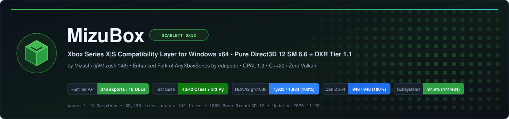
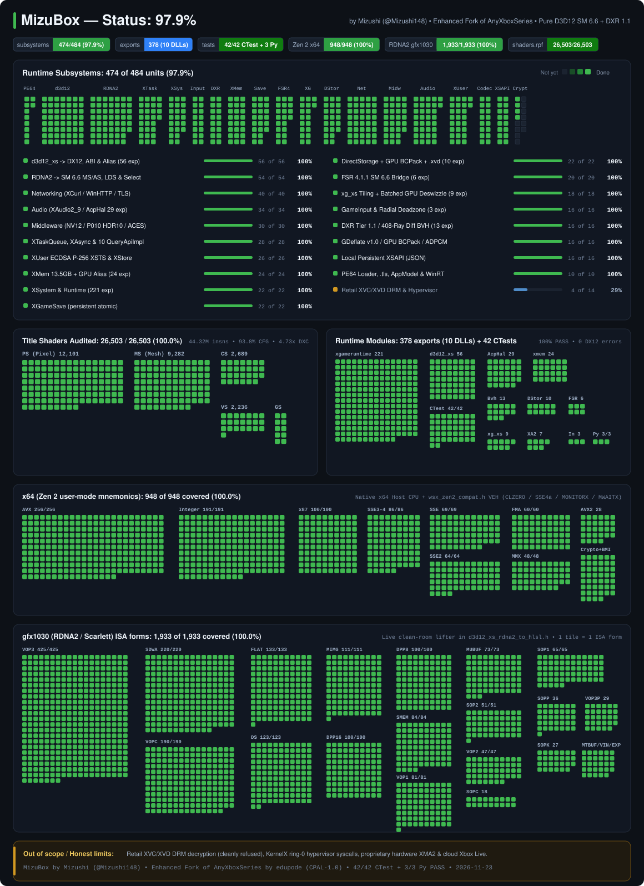
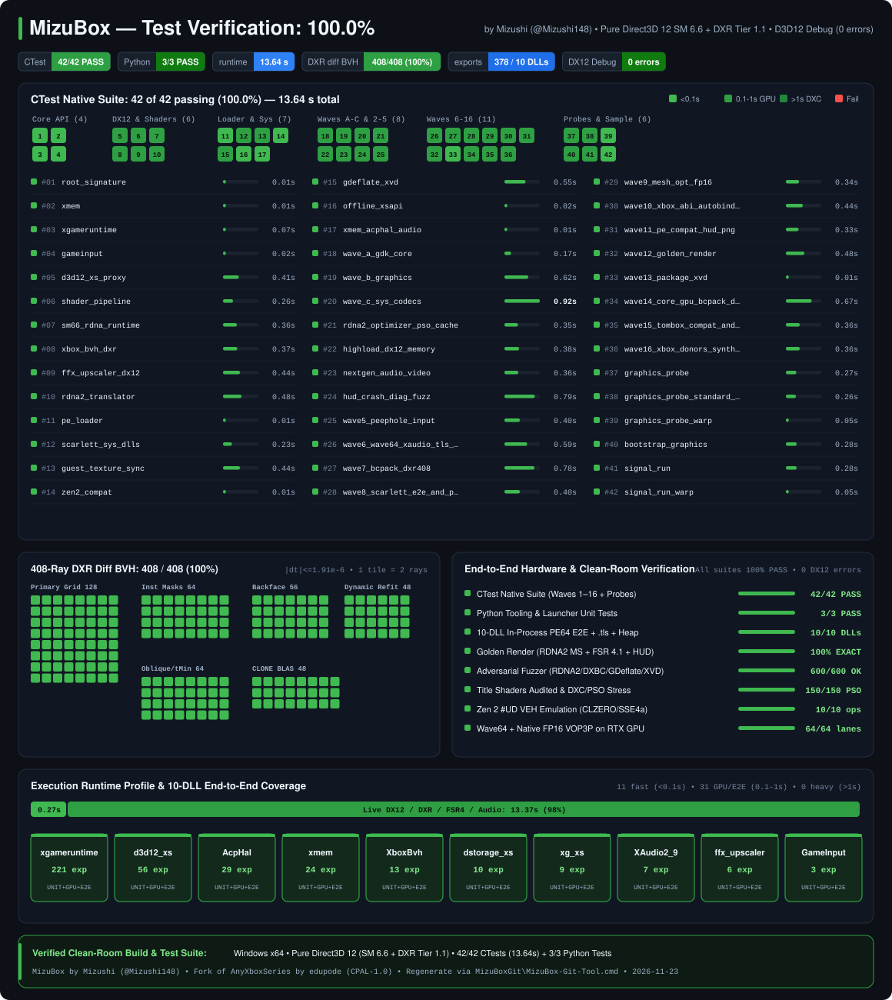

<div align="center">

<picture>
  
</picture>

<br/>

[](docs/BUILD.md)
[](docs/SHADER_ARCHITECTURE.md)
[](docs/COMPATIBILITY.md)
[](Test-MizuBox.cmd)
[](LICENSE)

<h3>
  Xbox Series X|S (Scarlett) Compatibility Layer for Windows x64<br/>
  <sub>Built by <a href="https://github.com/Mizushi148"><b>Mizushi</b></a> &bull; Enhanced Fork of <a href="https://github.com/edupode/anyxboxseries"><b>AnyXboxSeries by edupode</b></a></sub>
</h3>

[Quick Start](#-quick-start) &bull;
[Progress Dashboard](#-development-progress) &bull;
[Architecture](#-10-dll-scarlett-runtime-architecture) &bull;
[Test Verification](#-test-verification) &bull;
[Documentation](#-documentation) &bull;
[Credits & License](#-license--upstream-attribution)

</div>

---

## Overview

**MizuBox** is an experimental, clean-room **Xbox Series X|S (Scarlett)** compatibility layer written in **C++20** for **Windows x64**. It implements core Xbox console runtime DLLs, an in-process PE32+ manual mapper with AMD Zen 2 `#UD` emulation, and a **Pure Direct3D 12 (Shader Model 6.6 + DXR Tier 1.1)** graphics & RDNA2 (`gfx1030`) shader translation pipeline — with **zero Vulkan dependencies**.

> [!NOTE]
> **Project Scope:** The included **Signal Run** sample exercises the native runtime end-to-end, and the automated suite verifies individual APIs, GPU paths, RDNA2 shader lifting, DXR raytracing, and in-process PE64 execution. Commercial title compatibility remains experimental. This repository contains only clean-room source code, diagnostics, and synthetic test fixtures — **no game dumps, retail executables, console OS images, or DRM keys**.

---

## 📊 Development Progress

<div align="center">
  
</div>

### Key Engineering Highlights (Waves 1–16)
- **Pure Direct3D 12 SM 6.6 + DXR Tier 1.1 Graphics (`d3d12_xs.dll`):** Native Xbox D3D12.X ABI proxies, `0x00400000` console resource barrier sanitization, UMA `Texture1D/2D/3D` GPU VA & `Map()`/`Unmap()` sync with `MEM_WRITE_WATCH`, SM 6.6 GPU compute deswizzler, `ID3D12PipelineLibrary1` persistent binary PSO cache, hybrid QPC frame pacer, and live SM 6.6 Debug HUD (`F11` overlay + `F12` lossless PNG capture).
- **Clean-Room RDNA2 (`gfx1030`) → SM 6.6 HLSL → Signed DXIL Lifter:** Decodes all 14 GFX10.3 encodings (**1,933 / 1,933** ISA forms) across `PS`, `VS`, `GS`, `CS`, `AS`, and `MS` stages, including 4-tier structured CFG lowering (`StraightLine` → `Relooper` → `TopoDag` → `StateMachine`), Wave64 cross-warp `groupshared` emulation on 32-lane GPUs, and optional native FP16 `VOP3P`.
- **Hardware DXR & FidelityFX Drop-In Bridges:** Clean-room `XboxBvhBuilder.dll` routing BLAS/TLAS builds directly to hardware `ID3D12Device5` (verified with a **408/408** CPU-vs-DXR differential BVH suite) and `amd_fidelityfx_upscaler_xbox.dll` implementing FidelityFX API v2.0 temporal Lanczos-2 + YCoCg variance clipping + RCAS in pure SM 6.6.
- **In-Process PE32+ Loader & Zen 2 Compatibility:** Manual PE64 mapper with `.pdata` SEH unwinding, guest static `.tls`, 16-core Zen 2 affinity folding, AppModel/WinRT hooks, and Vectored Exception Handler emulation for all 7 AMD Zen 2 user-mode instructions on Intel CPUs (**948 / 948** mnemonics).
- **Storage, Audio & Offline GDK Runtime:** GPU SM 6.6 **GDeflate v1.0** + clean-room **BCPack** (`BC1`/`BC3`/`BC4`/`BC5`/`BC7`) inside `dstorage_xs.dll`, 3D HRTF + Schroeder-Moorer reverb + Catmull-Rom cubic resampling in `AcpHal.dll`, System32-bridged + clean-room 5.1 fallback `XAudio2_9.dll`, O(1) slab-pooled `xmem.dll`, and full offline JSON-persisted GDK/XSAPI in `xgameruntime.dll`.

---

## 🧩 10-DLL Scarlett Runtime Architecture

| Module | Exports | Role & Pure DX12 / Native Implementation |
|---|---:|---|
| `xgameruntime.dll` | **221** | Composite `XTaskQueue`, `XAsync`, transactional `XGameSave`, `XUser`, offline `XStore` & JSON-persisted `XSAPI`, `XNetworking` (WinHTTP/TLS), `QueryApiImpl` COM tables |
| `d3d12_xs.dll` | **56** | Xbox D3D12.X ABI proxy, RDNA2→SM 6.6 DXIL lifter, GPU compute deswizzler, UMA `Texture1D/2D/3D` sync, `ID3D12PipelineLibrary1` PSO cache, QPC frame pacer, Debug HUD |
| `AcpHal.dll` | **29** | APU heap/command ring, WASAPI output, SHAPE Catmull-Rom cubic SRC, 3D HRTF spatializer, Schroeder-Moorer reverb, soft-knee limiter, 5.1/7.1 downmix, IMA/MS-ADPCM |
| `xmem.dll` | **24** | 13.5 GB title VA allocator, O(1) 64 KB–2 MB slab pool, `XMemProtect`, physical alias mapping, cache flush, working-set telemetry |
| `XboxBvhBuilder.dll` | **13** | Exact MSVC-mangled drop-in bridge routing Xbox BVH prebuild / build / batched build / `CLONE` / rehydration directly to hardware **DXR Tier 1.1** |
| `dstorage_xs.dll` | **10** | Async `IDStorageQueueX` copy-queue uploader, RFC 1950/1951 inflate, GPU SM 6.6 **GDeflate v1.0**, **BCPack** texture codec, unencrypted `.xvd` container reader |
| `xg_xs.dll` | **9** | `IXGTextureAddressComputer` for `LINEAR`, `4KB_S/D`, `64KB_S/D`, RDNA2 `64KB_*_X` `pipe_bank_xor`, 3D Morton volume & MSAA 2x/4x/8x layouts |
| `XAudio2_9.dll` | **7** | Exact ordinal `#1`–`#5` bridge to `System32\XAudio2_9.dll` with anti-recursion guard + full clean-room 5.1 COM software mixer fallback |
| `amd_fidelityfx_upscaler_xbox.dll` | **6** | FidelityFX API v2.0 C exports (`FSR 4.1.1`) backed by runtime-compiled SM 6.6 Lanczos-2 temporal accumulation + 5-tap RCAS + reactive mask |
| `GameInput.dll` | **3** | COM `IGameInputForceFeedbackEffect`, Impulse Triggers, hot-plug device callbacks, radial deadzones, WASD/IJKL virtual gamepad |
| **Total** | **378** | **100% Pure Direct3D 12 + Native Windows x64 C++20 (Zero Vulkan)** |

---

## 🚀 Quick Start

### Prerequisites
- **Windows 10 / 11 (x64)** with a Direct3D 12 GPU (SM 6.6 + DXR Tier 1.1 recommended; WARP software fallback also supported)
- **Visual Studio 2022 / 2026** (or Build Tools) with **Desktop development with C++**, a recent Windows SDK, **CMake**, and **Ninja** *(bundled with Visual Studio)*
- **Python 3.10+** *(optional, for Python tooling unit tests)*

### 1-Click Build & Launch
```powershell
git clone https://github.com/Mizushi148/MizuBox.git
cd MizuBox

# Automatically detects Visual Studio, builds Release binaries, and launches Signal Run
.\Start-MizuBox.cmd
```

### Useful Commands
| Command | Purpose |
|---|---|
| `.\Start-MizuBox.cmd` | First-run auto-build + launch the included **Signal Run** sample |
| `.\Start-MizuBox.cmd --sample --warp` | Run Signal Run using the software Direct3D 12 **WARP** adapter |
| `.\Test-MizuBox.cmd` | Configure, build, and run all **42 CTest** suites + **3 Python** unit tests |
| `.\Run-GpuCheck.ps1` | Probe SM 6.6, Wave64, Mesh Shader, and run the **408-ray DXR differential BVH** check |

---

## ✅ Test Verification

<div align="center">
  
</div>

---

## 📚 Documentation

- **[Windows Build Guide](docs/BUILD.md)** — Manual CMake presets, Ninja builds, and toolchain setup
- **[Compatibility Matrix](docs/COMPATIBILITY.md)** — Detailed subsystem notes, Waves 1–16 verification, and middleware coverage
- **[Shader Architecture](docs/SHADER_ARCHITECTURE.md)** — `XDAT`/`NOBC`/`XBCH`/`FSSM` & `ACCC`/`FSPX` container formats and Pure DX12 SM 6.6 lifter internals
- **[Credits & Attribution](CREDITS.md)** — Full copyright and CPAL-1.0 attribution notices

---

## ⚖️ License & Upstream Attribution

**MizuBox** by **[Mizushi (@Mizushi148)](https://github.com/Mizushi148)** is an enhanced fork of **[AnyXboxSeries by edupode](https://github.com/edupode/anyxboxseries)**.

This project is distributed under the **[Common Public Attribution License Version 1.0 (CPAL-1.0)](LICENSE)**.  
Please preserve the original upstream credit to **AnyXboxSeries by edupode** and all license notices when redistributing covered code. See [CREDITS.md](CREDITS.md) and Exhibit B of [LICENSE](LICENSE) for full details.
